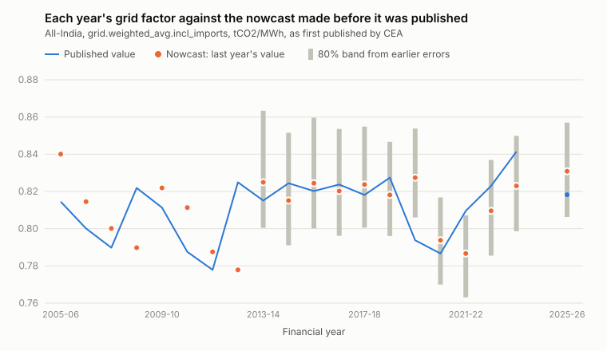

# Nowcast results: predicting the grid factor before CEA publishes it

_Generated by `scripts/nowcast.py` from `data/cea/factors.csv`. Do not edit by hand._

Real data: CEA CO2 Baseline Database v1.0–v22.0. Each target is a financial year's **first-published** all-India value. Each forecast uses only values from versions published **before** that one (`docs/NOWCAST.md`). Errors are in percent of the published value.

**Scope 2 qualifier.** An error of *e* in the grid factor moves an entity's emission intensity by *e* times the Scope 2 share of its target basis (`docs/RQ1_RESULTS.md`), not by *e*.

## Headline

- **"Use last year's value" was wrong by 1.99% on average** (RMSE 2.41%, worst -5.70%) over 20 years of `grid.weighted_avg.incl_imports`.
- **Nothing simple beat it.** It had the lowest mean absolute error of the five models, and no alternative won in more than half of the years.
- **A band built from earlier errors held up:** the 80% band contained 10 of 12 later values, the 90% band 11 of 12.
- **Which version matters far less than which year:** the median restatement of a year, first to latest version, is 0.073%, against a 1.99% mean error from using the wrong year.
- **For the series CarbonX uses, the FY2025-26 value fell outside the 90% band** drawn from earlier years: published 0.6751, band 0.6874 to 0.7400. The fall that year was large by the standard of the previous two decades.

## Backtest: `grid.weighted_avg.incl_imports`

| model | years | mean abs. error | RMSE | bias | worst | beats naive | sign-test p |
|---|---|---|---|---|---|---|---|
| naive (last year's value) | 20 | 1.99% | 2.41% | +0.10% | -5.70% | – | – |
| drift (average change so far) | 20 | 2.04% | 2.55% | +0.03% | -6.15% | 7/20 | 0.26 |
| recent drift (last three changes) | 20 | 2.31% | 3.00% | -0.05% | -7.15% | 6/20 | 0.12 |
| linear trend | 20 | 2.84% | 3.14% | -0.82% | -5.38% | 7/20 | 0.26 |
| AR(1) on changes | 20 | 2.12% | 2.67% | -0.28% | -6.54% | 8/20 | 0.50 |

*Beats naive* counts the years with a smaller absolute error than the naive forecast. The sign test asks whether that count differs from a coin toss; with about twenty years it can only detect a large difference. Five models were tried, so one small p-value among them would not be evidence either.

Years not used: FY2024-25: FY2023-24 was not yet published when v21.0 came out, so this is not a one-year-ahead case.

## The same backtest on other long series

### `grid.operating_margin.incl_imports`

| model | years | mean abs. error | RMSE | bias | worst | beats naive | sign-test p |
|---|---|---|---|---|---|---|---|
| naive (last year's value) | 21 | 1.23% | 1.47% | +0.30% | +3.19% | – | – |
| drift (average change so far) | 21 | 1.28% | 1.52% | +0.08% | +3.14% | 10/21 | 1.00 |
| recent drift (last three changes) | 21 | 1.49% | 1.80% | +0.07% | -3.66% | 8/21 | 0.38 |
| linear trend | 21 | 1.56% | 1.78% | -0.18% | -3.18% | 7/21 | 0.19 |
| AR(1) on changes | 21 | 1.51% | 1.79% | +0.13% | +3.92% | 6/21 | 0.08 |

### `grid.weighted_avg.excl_imports`

| model | years | mean abs. error | RMSE | bias | worst | beats naive | sign-test p |
|---|---|---|---|---|---|---|---|
| naive (last year's value) | 19 | 1.75% | 2.19% | +0.19% | -5.68% | – | – |
| drift (average change so far) | 19 | 1.79% | 2.33% | +0.13% | -6.10% | 7/19 | 0.36 |
| recent drift (last three changes) | 19 | 2.18% | 2.80% | -0.04% | -7.19% | 4/19 | 0.02 |
| linear trend | 19 | 2.42% | 2.74% | -0.40% | -5.17% | 7/19 | 0.36 |
| AR(1) on changes | 19 | 1.84% | 2.39% | -0.19% | -6.51% | 8/19 | 0.65 |

## Nowcasts for the series CarbonX calculates with

`grid.weighted_avg_incl_re_captive.incl_imports` has only 2 usable one-year-ahead cases, too few to fit or test anything. The point nowcast is its own last known value. The band borrows the percentage errors of the headline series from earlier years, which assumes the two series miss by similar proportions: an assumption, not a result.

| year | nowcast | 80% band | 90% band | published |
|---|---|---|---|---|
| FY2025-26 | 0.7097 | 0.6887 to 0.7320 | 0.6874 to 0.7400 | 0.6751 (+5.12% error) |
| FY2026-27 | 0.6751 | 0.6552 to 0.6956 | 0.6542 to 0.7032 | not yet published |

The FY2026-27 row is a prediction made on the v22.0 data, before CEA has published that year. It can be checked when the next version appears.

## How CEA revises a year after first publishing it

| series | restatement | cases | median abs. change | largest | mean signed |
|---|---|---|---|---|---|
| grid.weighted_avg.incl_imports | 1 | 25 | 0.037% | 0.742% | -0.032% |
| grid.weighted_avg.incl_imports | 2 | 23 | 0.138% | 0.997% | -0.050% |
| grid.weighted_avg.incl_imports | 3 | 22 | 0.154% | 0.997% | -0.052% |
| grid.weighted_avg.incl_imports | 4 | 17 | 0.073% | 0.959% | -0.154% |
| grid.weighted_avg.incl_imports | 5 | 7 | 0.001% | 7.057% | -1.118% |
| grid.weighted_avg.incl_imports | latest | 25 | 0.073% | 0.959% | -0.057% |
| grid.weighted_avg_incl_re_captive.incl_imports | 1 | 6 | 0.285% | 0.777% | -0.309% |
| grid.weighted_avg_incl_re_captive.incl_imports | 2 | 4 | 0.278% | 0.777% | -0.336% |
| grid.weighted_avg_incl_re_captive.incl_imports | 3 | 1 | 0.000% | 0.000% | +0.000% |
| grid.weighted_avg_incl_re_captive.incl_imports | latest | 6 | 0.285% | 0.777% | -0.313% |

*Restatement 1* is the first later version that republished the year, and so on; *latest* compares the first and the newest value.

**One anomaly.** FY2016-17 moved by -7.06% at its restatement 5. The value is in CEA's own workbook (v18.0, `Results!N13`, 0.7656; versions 13 to 17 and 22 give 0.8237 for the same year). It is close to the renewables-inclusive figure one row below it. We do not know whether it is a slip or a deliberate one-off; it is a question for CEA. A reader of v18.0 alone would have seen it as the official value.

## What this does and does not show

- It **measures** the cost of the "latest at the deadline" reading of BEE's rule: historically about 2% of the factor, sometimes 5 to 6%.
- It gives the grid factor an **empirical forecast band**. That is the uncertainty of a guess made before publication. It is not an uncertainty of the published factor, and `carbonx.uncertainty` does not use it.
- It does **not** show that the factor is unpredictable in principle. It shows that about twenty yearly values cannot support anything beyond the naive forecast. A model using generation-mix data would do better, but CEA computes the factor from that data, so that would be accounting, not forecasting.
